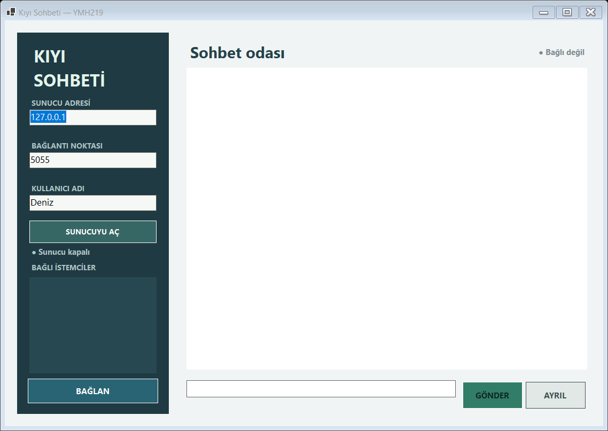
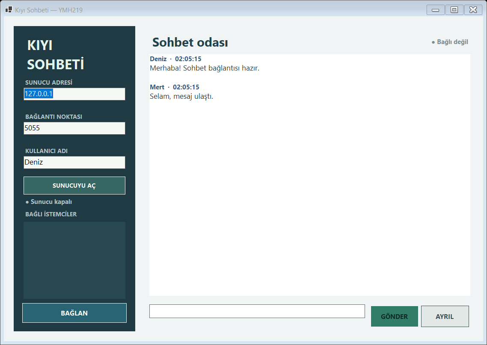

# YMH219 — Kıyı Sohbeti

TCP üzerinden aynı bilgisayardaki veya yerel ağdaki istemciler arasında zaman damgalı mesaj aktarımı yapan Windows Forms uygulamasıdır. Her uygulama örneği hem sunucu açabilir hem de bir sunucuya istemci olarak bağlanabilir.

## Teknoloji

- C# / .NET 10, Windows Forms
- `TcpListener`, `TcpClient`, `StreamReader` ve `StreamWriter`
- JSON satır protokolü, `async`/`await`
- NuGet paketi gerektirmez

## Özellikler

- Sunucu başlatma, kullanıcı adıyla bağlanma, mesaj gönderme ve ayrılma
- Zaman bilgisi; kendi mesajları ile diğer katılımcıların mesajları farklı renkte
- Sunucu tarafında bağlı istemci listesi
- Hata durumlarında açıklayıcı mesaj; arayüz kapanmadan hata yönetimi

## Kurulum ve çalıştırma

```powershell
git clone https://github.com/Halit1elnehsen/YMH219-ChatApp.git
cd YMH219-ChatApp
dotnet restore
dotnet run
```

Windows 10/11 ve .NET 10 SDK gerekir. Aynı bilgisayarda deneme için ilk pencerede **Sunucuyu Aç** düğmesine basın; ikinci bir uygulama örneği başlatın, `127.0.0.1` ve aynı portu kullanarak **Bağlan** düğmesine basın. Yerel ağda istemci adresine sunucu bilgisayarının yerel IP adresini yazın; güvenlik duvarında seçilen TCP portuna izin gerekebilir.

## Ekran görüntüleri





## Test ve sınırlamalar

Yerel TCP işlev kontrolünde iki istemciyle iki yönlü mesajlaşma, bağlantıyı kesme ve aynı istemciyle yeniden bağlanma doğrulandı. Formların mouse/klavyeyle etkileşimi masaüstü UI otomasyonu engeli nedeniyle elle denenemedi. Uygulama TLS, kullanıcı doğrulaması veya internet üzerinden güvenli dağıtım sağlamaz; sınıf ve yerel ağ demonstrasyonu içindir.

## Öğrenci

**Halid Elnehsen — 250541617**
